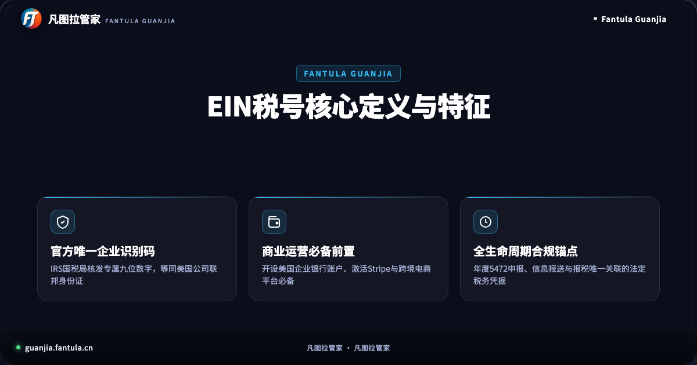
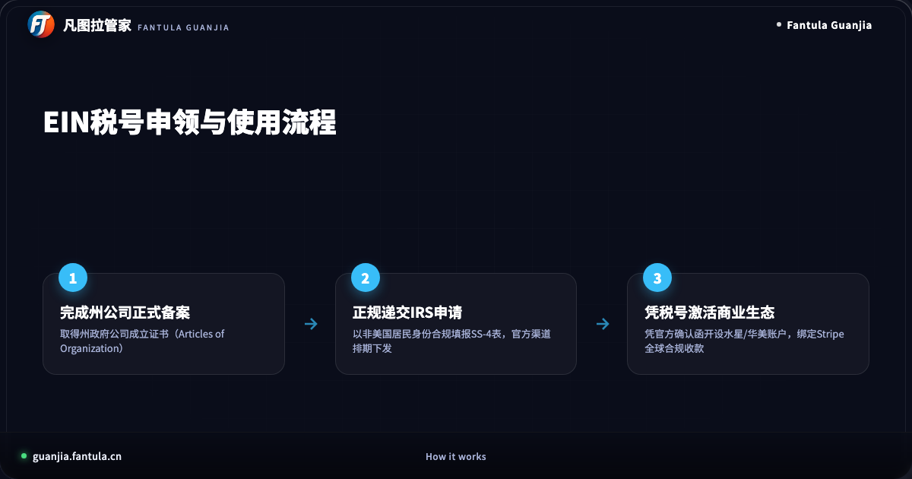

# 最新EIN税号是什么？美国公司拿到税号怎么用看这3点

EIN（Employer Identification Number，雇主身份识别号）是美国国税局（IRS）为在美国运营的企业核发的九位数专属税号，相当于美国公司的“企业身份证”。没有美国社安号（SSN）的外国创业者，在完成公司注册后同样必须申领 EIN，才能合规办理企业银行开户、绑定 Stripe 收款以及处理年度税务申报。

很多初次出海的创业者往往有一个误区，以为拿到了州政府颁发的公司成立证书（Articles of Organization），公司就已经可以全面开展经营了。但实际上，没有 EIN 税号，你的美国公司就无法开设独立的商业银行账户，无法开通国际支付网关，也无法合规完成年度联邦税务申报。

## 一、为什么注册完美国公司，必须第一时间申请EIN？

在美国设立公司是“州层级”的行为，由各州州务卿（Secretary of State）负责登记并发放证书。但只要你的公司要开展商业交易、雇佣人员或者与金融机构对接，就必须进入“联邦层级”的税务与监管体系，这就由美国国税局（IRS）来统一管辖。

EIN 税号就是美国国税局用来识别每一家纳税主体的唯一代码。它的标准格式是“XX-XXXXXXX”九位数字。无论你是设立在怀俄明州（Wyoming）、特拉华州（Delaware）的有限责任公司（LLC），还是股份有限公司（C-Corp），只要涉及到跨境电商、海外独立站收款或软件出海，申领 EIN 都是无法跳过的必经之路。

## 二、EIN税号拿到之后，核心用在哪3个场景？

拿到美国国税局下发的 EIN 税号及官方确认信后，企业才可以真正打通跨境商业闭环。具体而言，核心应用在以下三个不可或缺的场景中：

### 1. 开设美国企业商业银行账户
无论是申请传统实体银行（如华美银行 East West Bank、国泰银行），还是申请主流的新型商业数字银行（如 Mercury、Relay），银行在执行严格的开户审核（KYC/KYB）时，EIN 都是最核心的法定证明文件。银行需要通过国税局的税号记录来核实企业的合法存续与合规背景，没有正规税号，任何合规商业银行都不会受理开户申请。

### 2. 激活全球支付网关与电商平台入驻
做跨境独立站出海，接入 Stripe、PayPal Business 等国际主流收单网关是业务开展的前提。在注册美区商业账户时，平台必须强制校验公司的 EIN 税号及法人信息。此外，入驻亚马逊北美站、TikTok Shop 跨境美区店铺、沃尔玛平台或苹果开发者企业账号时，EIN 同样是完成税务合规审查（W-9 / W-8BEN-E 认证）的基础要素。

### 3. 处理年度税务与合规信息申报
即使你的美国公司没有在美国本土产生实质业务关联（ETBUS），根据美国联邦税法规定，外资持股比例达到 25% 及以上的单一成员 LLC，每年依然必须向国税局申报 Form 5472 与 Form 1120 信息报表。这类申报的抬头与匹配依据就是 EIN。如果未按时申报或申报信息缺失税号，可能面临单年度两万五千美元的高额行政罚单。

## 三、警惕套路：低价“秒出EIN”背后的巨大隐患

正因为国内出海创业者大多没有美国社安号（SSN）或个人税号（ITIN），无法通过 IRS 官网系统在线即时生成税号，必须走正规的 SS-4 表格向国税局递交审核。这通常需要一定的官方工作日排期。

部分不良中介利用创业者急于拿到税号开户的心理，推出了所谓的“加急秒出税号”服务。其背后的黑幕往往是盗用他人已有的 SSN 作为所谓“责任人”（Responsible Party）在 IRS 官网在线生成。这种违规操作具有极其严重的隐患：

* **开户失败或封控**：一旦银行或支付平台（如 Stripe）在后台核验责任人信息与实际公司成员不一致，会立即判定为冒用身份欺诈，导致账户直接冻结、资金受限。
* **无官方正规凭证**：黑代办往往只能给客户发一串九位数字，根本无法提供美国国税局官方盖章下发的正式确认函（CP 575 或 147C 函件），后续在银行年审或平台复核时必定露馅。
* **资产权属隐患**：责任人不是公司实际控制人，在法律层面甚至可能带来公司资产被冒名主张的法律风险。

因此，出海合规绝不能图一时之快而走偏门，唯有通过正规合法渠道向国税局申报，才能保障海外资产的长久安全。

## 四、没有SSN，如何合规申领EIN税号？

对于没有美国本土身份的中国跨境创业者，合规申领 EIN 的标准路径是清晰明确的。

* **第一步：取得州政府正式成立证书**：在申请 EIN 之前，必须先在选定州（如怀俄明州）完成 LLC 设立，取得官方正式盖章的成立文件。因为国税局在审核税号申请时，会严格校验公司在所属州的真实合法登记状态。
* **第二步：合规填报并递交 Form SS-4**：作为非美国税务居民，在表格对应栏位明确注明申请人无需且未持有 SSN/ITIN，由正规法定代办人将完整表格递交至美国国税局指定处理中心。
* **第三步：等待国税局审核下发并云端归档**：国税局完成审核后，会正式核发专属九位 EIN，并寄送官方确认信（CP 575 函件）。企业应及时将该文件存入数字化企业文件柜妥善保管，以便开户及后续合规审核随时调取。

## 五、常见问题解答（FAQ）

### 1. ein税号怎么用？
拿到 EIN 税号后，最核心的用途包括：在申请 Mercury、Relay 等商业银行账户时作为企业纳税人识别号填报；在开通 Stripe、PayPal 等支付收单网关时完成商家税务信息认证；在入驻亚马逊、TikTok Shop 等平台时填写 W-9 表单；以及在每年向美国国税局报送 5472 合规表单时代入企业联邦标识。使用时请务必配合国税局出具的官方确认函一同留存证明。

### 2. ein税号可以查询到吗？
美国国税局出于纳税人隐私保护原则，并没有面向公众开放完全免费公开的 EIN 全量在线查询数据库。一般公众无法随意搜索私营 LLC 的税号。但如果你是公司所有者，可以通过查看国税局下发的 CP 575 确认信、过往的银行对账单、报税表单或者直接致电 IRS 商业与专业税务热线，提供公司法定信息后核实税号。正规代办机构也会在系统中为企业保留官方存根以供调取。

### 3. 美国ein怎么申请？
如果你有美国社安号（SSN），可以直接在 IRS 官网在线即时申领；如果你是非美国居民且没有 SSN，则需要填写 IRS Form SS-4 表格，准备好所属州的注册证书，通过传真、信件或委托专业申报团队向国税局办理。由专业服务机构进行规范填报，能够有效规避因表格信息有误被国税局退回的风险。

## 六、关于凡图拉管家

凡图拉管家（guanjia.fantula.cn）专注于为跨境电商、独立站出海、软件开发团队及出海创业者提供全流程合规托管服务。平台支持怀俄明州 LLC 设立、美国国税局正规 EIN 税号代办、官方商业注册地址、州年报主动提醒以及 5472 年度税务申报，所有规费透明一口价，未向官方递交前支持全额退款。

出海合规是一场长跑，筑牢底层的企业架构与财税基石，才能让业务在全球市场中行稳致远。

---

> 原文：[最新EIN税号是什么？美国公司拿到税号怎么用看这3点](https://guanjia.fantula.cn/help/article/what-is-ein-and-how-to-apply)
