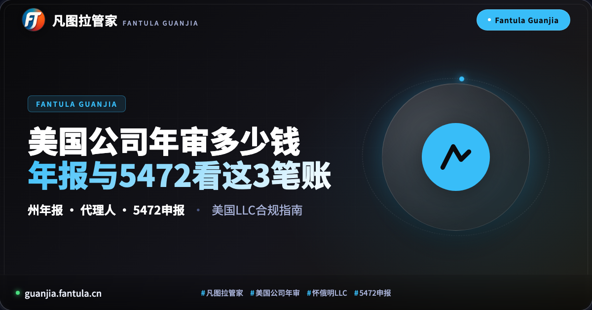
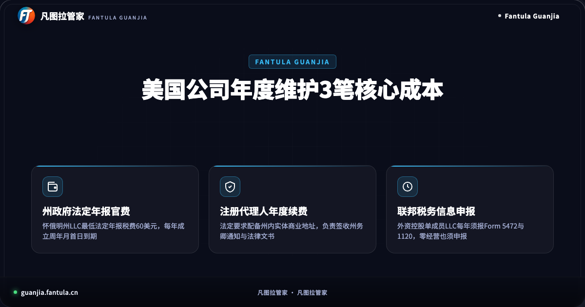
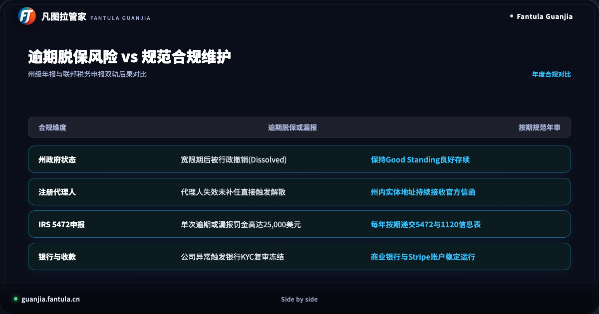
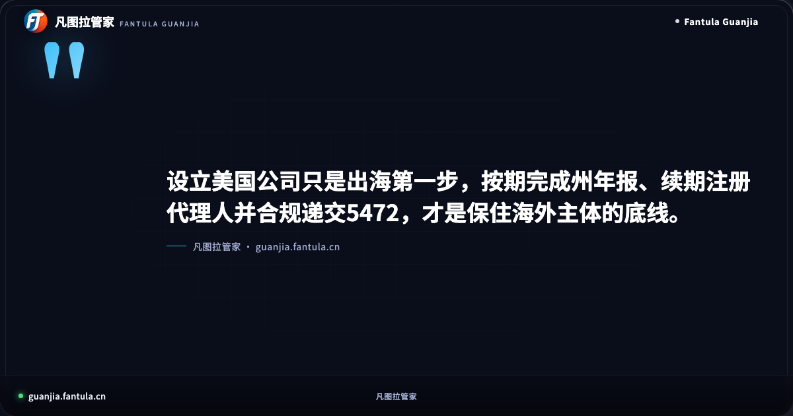
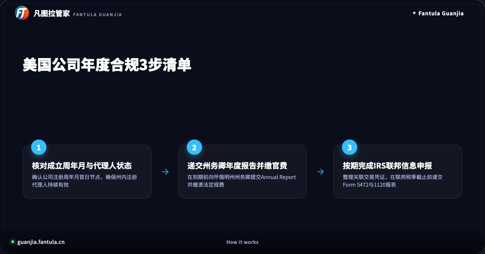

# 美国公司年审一般多少钱？怀俄明州年报与5472合规看这3笔账

美国公司年审一般多少钱？以跨境出海最常见的怀俄明州有限责任公司（Wyoming LLC）为例，一年的维护成本并非单一收费，而是由三笔明细构成：第一笔是州政府法定年报官费，怀俄明州最低标准为 60 美元（若公司在州内资产超过 30 万美元则按资产额的万分之二计收）；第二笔是法定注册代理人（Registered Agent）年度续费；第三笔是面向美国国税局（IRS）的联邦税务信息申报服务费。提前看懂这三笔账，就能避免次年被隐形加价或因逾期脱保吃罚单。

许多创业者在注册完美国公司、拿到州政府成立证书和 EIN 税号后，容易产生「一劳永逸」的误解。事实上，美国商事体系遵循「宽进严管」原则：成立门槛不高，但公司存续期间每年的州级年报与联邦信息申报都是强制法定义务。

## 一、美国公司年审费用拆解：到底包含哪3笔支出？

很多企业在对比不同服务商报价时，常发现市场上从几百元到数千元不等，核心原因在于报价口径不统一。拆开来看，美国 LLC 每年的刚性合规支出清晰地分为三块：

### 1. 州政府法定年报官费（Annual Report License Tax）
美国各州政府要求在本州登记的公司每年提交一次年度报告，用来确认公司仍在正常存续并更新基础备案信息。以怀俄明州为例，根据怀俄明州州务卿（Wyoming Secretary of State）公开收费标准，LLC 年度许可税的最低起征额为 60 美元；只有当公司位于怀俄明州境内的实际资产超过 30 万美元时，才按州内资产价值的 0.0002（万分之二）计算，二者取高者。对于绝大多数以跨境电商、独立站收款或软件出海为主、在怀俄明州本土无实体重资产的企业来说，每年州政府官费就是固定的 60 美元（线上刷卡另含少量官方支付通道手续费）。

### 2. 注册代理人年度续费（Registered Agent Renewal）
按照怀俄明州商事法规，每一家在该州设立的公司都必须常年指定一名在州内拥有真实实体街道地址的注册代理人，负责在工作日正常签收州政府寄送的合规通知与法律传票。非美国本地居民无法自行担任，因此首年注册通常包含首年代理服务，从第二年开始需按年续期。这也是传统低价中介最容易埋坑的环节——首年报极低价吸引签约，次年续期时漫天要价，甚至对扫描官方信件按件加收费用。

### 3. 联邦层面的税务与信息申报（IRS 合规）
州年报只向州政府报备，并不等于完成了联邦税务申报。根据美国国税局（IRS）关于 Form 5472 的官方填报说明，由非美国居民外国人直接或间接持有 100% 股权的单成员 LLC（Foreign-Owned Single-Member LLC），即使全年在美国境内没有产生实质营收，也必须在每个纳税年度按期提交 Form 5472 与简化版 Form 1120 信息报表，披露企业与境外关联方之间的资金往来。具体委托申报服务费因账务复杂程度与服务机构标准而异，签约前应以服务方当期公示价格为准并确认所含明细。

## 二、美国公司年报时间与逾期后果：千万别踩这2条红线

把费用拆清楚之后，更关键的是盯紧时间节点。美国公司年度维护有两条不可触碰的红线：一条在州政府，一条在国税局。

在州政府层面，怀俄明州 LLC 的年报截止日期固定为公司成立周年月的第一天。例如，如果你的公司是在 2025 年 11 月 18 日注册成立的，那么从 2026 年起，每年的年报到期日就是 11 月 1 日（州务卿系统通常提前开放窗口以便提早递交）。如果超过到期日未缴纳年报税费，州政府在宽限期过后会将公司状态直接变更为行政撤销（Administratively Dissolved）。一旦公司失去良好存续状态（Good Standing），不仅后续无法正常续签商业合同，更容易触发美国商业银行或 Stripe 支付网关的风控复核，导致账户被限制或冻结。

在联邦层面，风险则更为直接。IRS 对外资单成员 LLC 未按期提交、漏报或严重错报 Form 5472 设定了极其严厉的法定行政罚金：每次违规罚款高达 25,000 美元；如果收到国税局书面通知后 90 天内仍未补救，每逾期 30 天还将叠加额外的 25,000 美元罚金。因此，切不可因为公司暂时没有大额盈利就忽略联邦信息申报。

## 三、避坑指南：为什么「低价注册」次年年审总被收割？

不少出海团队在成立第一年只比谁家注册费最低，到了第二年才发现维护成本远超预期。行业里常见的三类隐形陷阱值得提前核查：

* **报价拆分模糊**：广告只报纯代理跑腿费，刻意隐瞒 60 美元州政府官费或次年注册代理人地址续费，临近到期才临时通知补交。
* **地址共享无预警**：部分低价渠道把客户塞进无人值守的批量地址，既收不到州务卿寄出的催告信，也没有自动到期提醒机制，等到客户自己查册时公司早已被行政撤销，恢复状态（Reinstatement）还要额外支付高额滞纳金与恢复官费。
* **重设立轻税报**：只负责前端卖执照，完全不提醒外资 LLC 必须申报 Form 5472，导致企业在成立满一年后错过联邦税季截止日，陷入被动申诉局面。

选择年度合规服务时，建议重点核实三件事：官费与服务费是否白纸黑字写清、是否提供到期前主动提醒与官方回执原件存档、是否同时具备州年报与 5472 申报的协同处理能力。

## 四、美国公司年度合规怎么操作？3步走完不脱保

只要在公司成立后建立起清晰的年度合规日历，每年的维护流程其实非常有规律，按三步推进即可稳妥完成：

* **第一步：锁定成立周年月并核查代理人有效状态**：翻出公司成立证书（Articles of Organization），记下注册月份，提前 30 至 60 天核对注册代理人是否正常在任，避免因代理人断档触发州政府解散程序。
* **第二步：按期递交州年报并留存官方回执**：登录怀俄明州州务卿在线系统或交由合规托管团队统一申报，如实确认办公地址与州内资产数据、缴清 60 美元法定年报税费，完成后将官方年报回执（Annual Report Receipt）归档保存，用于银行年审备查。
* **第三步：在联邦税季前完成 Form 5472 与 Form 1120 信息申报**：按自然年度整理公司与股东之间的出资、代付、分红等关联流水记录，在次年联邦法定截止日（通常为 4 月 15 日，若需延期须提前提交延期申请）前规范报送并保留递交回执。需要说明的是，本文仅梳理公开法规框架，具体个案税务认定建议结合自身架构咨询持牌美国注册会计师。

## 五、常见问题解答（FAQ）

### 1. 美国公司年报时间是什么时候？
美国各州规定不同。以怀俄明州 LLC 为例，年报到期日为每年公司成立周年月的第 1 天（例如 5 月成立的公司，每年 5 月 1 日到期），州政府系统支持在到期前提前申报。其他州如特拉华州 LLC 则实行统一截止日期（每年 6 月 1 日前缴纳年度特许税），建议以公司成立证书所示州属法规为准。

### 2. 美国公司年审和报税的区别是什么？
二者归属不同层级、缺一不可。「年审（年报）」是向**州政府**（州务卿）提交的商事存续备案，用来更新公司基础信息并缴纳州年度许可税，确保公司主体合法有效；「报税（税务/信息申报）」则是向**联邦国税局（IRS）**及适用州税务局递交财务或信息报表（如外资 LLC 必报的 Form 5472 与 Form 1120），用于履行联邦税法披露义务。只做年审不做联邦申报，依然会面临 IRS 罚单。

### 3. 5472申报是什么意思？没有经营也要报吗？
Form 5472 是美国国税局专门用于监管外资持股 25% 及以上美国公司（包含外国人 100% 持股的单成员 LLC）跨境关联交易的信息申报表。即使公司全年零营收、未开设银行账户，只要存在股东垫付注册费、注入资本金等可报告交易（Reportable Transactions），通常仍需按规定连同简化版 Form 1120 一起申报；逾期或漏报的法定罚金为 25,000 美元起。

## 六、关于凡图拉管家

凡图拉管家（guanjia.fantula.cn）面向出海企业与跨境创业者提供全中文、流程透明的美国公司设立与长期合规托管服务，涵盖怀俄明州 LLC 注册、EIN 联邦税号申领、合规注册代理人续期、州政府年报到期预警代办以及 Form 5472 年度合规申报。各项官费与服务费明细均在平台公开展示，未向官方正式递交前支持全额退款，并配备企业专属数字化文件柜留存全部官方证书与年报凭证，让出海团队省心守住合规底线。

---

> 原文：[美国公司年审一般多少钱？怀俄明州年报与5472合规看这3笔账](https://guanjia.fantula.cn/help/article/us-company-annual-report-cost-and-5472-compliance)
