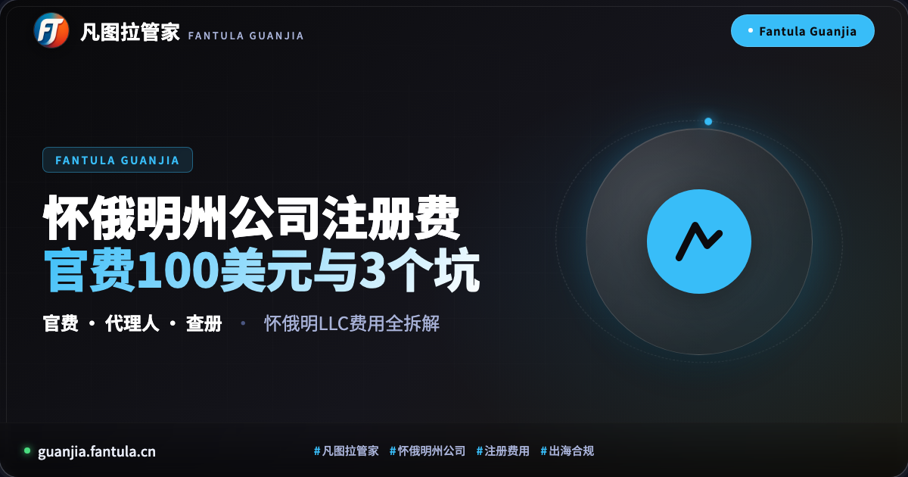
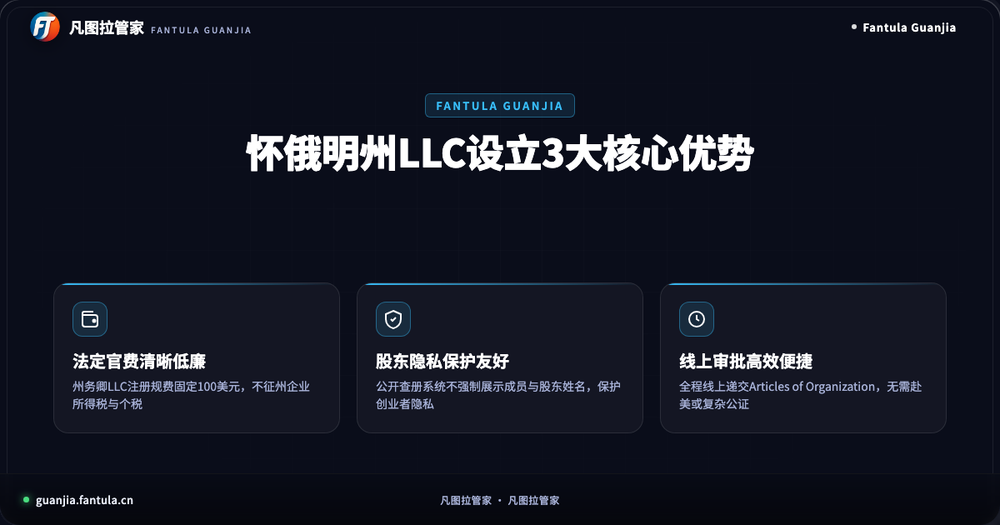
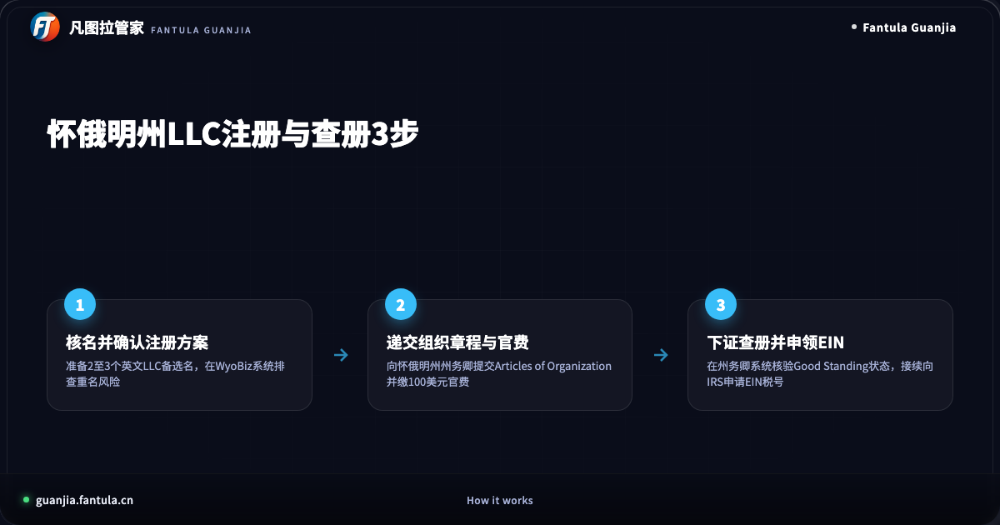

# 怀俄明州公司注册费多少钱？官费100美元与隐藏成本看这3点

怀俄明州公司注册费多少钱？直接看官方底价：根据怀俄明州州务卿（Wyoming Secretary of State）公布的商事收费标准，注册一家怀俄明州有限责任公司（LLC）向州政府缴纳的法定成立官费（Articles of Organization）为 100 美元（在线通过 WyoBiz 系统刷卡递交会另收少量支付通道手续费）。除此之外，非美国本地居民设立怀俄明州公司还必须配备一名州内实体注册代理人（Registered Agent），并在拿证后向美国国税局（IRS）申领 EIN 联邦税号，因此最终总花费由「州政府 100 美元官费 + 代理人及代办服务费 + 后续税号申领」共同决定。

很多跨境电商卖家、独立站团队和独立开发者在比价时，常被市场上从几百元到上万元不等的报价弄糊涂。把怀俄明州注册的官方成本和常见隐藏收费拆开看，就能一眼分辨哪些报价靠谱、哪些是后期加价的套路。

## 一、为什么跨境创业者偏爱怀俄明州？3大核心优势拆解

在美国五十个州里，怀俄明州是美国 LLC 制度的发源地，也是中国出海创业者落地轻量级海外主体的高频选择，核心原因在于三点：

* **税负结构简单透明**：怀俄明州不征收州级企业所得税，也不征收州级个人所得税，对于主要通过跨境独立站、海外软件订阅或北美电商平台收款、在怀俄明州本地无实体仓库与重资产的公司来说，州级税务维护负担极轻。
* **成员隐私保护程度高**：怀俄明州公开商事查询系统不强制披露 LLC 股东（Member）与经理（Manager）的个人姓名，能够有效降低企业实际控制人信息被公开检索的风险。
* **长期存续成本可控**：除首年 100 美元法定成立官费外，次年起怀俄明州 LLC 年度报告（Annual Report）的最低法定许可税仅为 60 美元（州内资产超过 30 万美元才按资产额万分之二计收），远低于加州等每年动辄八百美元特许税的高成本州。

## 二、怀俄明州公司注册费避坑：一定要核对的3个隐藏成本点

既然怀俄明州政府收取的法定成立官费只有 100 美元，为什么同样是办怀俄明州 LLC，不同机构的报价差好几倍？签约前必须盯紧以下三处最容易藏坑的明细：

### 1. 广告报价是否把 100 美元州官费拆了出去
部分低价引流广告只报纯人工跑腿费，刻意用极低数字吸引咨询，等客户付款提交护照资料后，再通知补交 100 美元州务卿官费、章程备案费或电子证书下载费。正规报价应在递交前明确写清是否全含政府法定规费，避免中途二次收费。

### 2. 注册代理人地址费与收件扫描费有没有暗藏加价
怀俄明州法律强制要求每家公司必须指定一名在怀俄明州境内拥有真实实体街道地址的注册代理人，负责在工作日正常签收州务卿寄发的官方通知与法律文书。非美居民无法用国内地址或普通邮箱代替。很多低价中介首年把代理人费用压得很低，但第二年续期时大幅涨价，甚至每代收一封州政府纸质信件都要额外收取高额扫描费。

### 3. EIN 联邦税号与官方凭证交付是否规范
拿到州政府签发的成立证书后，公司必须向美国国税局（IRS）申领九位 EIN 雇主身份识别号，才能开设水星（Mercury）、Relay 等美国企业商业银行账户或绑定 Stripe 全球收款。没有美国社安号（SSN）的创业者需走正规 Form SS-4 通道向 IRS 递交申请并取得 CP 575 或 147C 官方确认函。核对报价时，一定要看清是否包含 EIN 正规申报，切忌贪图所谓「极速秒出」而踩入冒用他人 SSN 的封号雷区。

## 三、拿到证书后怎么验真？怀俄明州公司查询实操步骤

无论是自己办理还是委托服务机构注册，拿到电子成立证书后，都建议第一时间亲自去怀俄明州州务卿官方数据库验真，确认公司已正式登记且处于良好存续状态（Active / Good Standing）：

1. 打开怀俄明州州务卿商事门户（WyoBiz 商业实体查询入口）。
2. 在搜索栏输入公司英文全称或证书上的 Filing ID（备案编号），点击查询。
3. 核对三项核心信息：公司状态是否为 Active、成立日期是否与证书一致、注册代理人（Registered Agent）名称与州内实体街道地址是否真实有效。

能够直接在州务卿官方公开系统查到完整备案记录，才证明注册官费已真实缴入州政府且主体合法存续。

## 四、怀俄明州公司注册标准流程：3步清晰落地

只要提前准备好 2 至 3 个英文公司备选名称、主营业务简述以及负责人的有效护照信息，全程线上即可推进怀俄明州 LLC 设立：

* **第一步：英文核名与方案确认**：在怀俄明州州务卿系统检索备选英文名，确认不与州内已存续公司重名，同时避免使用银行、保险、信托等受限词汇；确认注册费用全含范围与退款条款。
* **第二步：递交组织章程并缴清 100 美元官费**：向怀俄明州州务卿正式提交 Articles of Organization，指定合规的州内注册代理人，完成法定规费缴纳并等待州系统审批下发电子版成立证书。
* **第三步：官方查册归档并申领 EIN 税号**：在州系统验真公司状态，将成立证书、组织章程与代理凭证妥善留存，随即以非美居民身份合规填报 Form SS-4 申请 EIN，为后续开立企业银行账户与搭建全球收款做好准备。

## 五、常见问题解答（FAQ）

### 1. 怀俄明州公司注册需要本人去美国吗？
不需要。怀俄明州对 LLC 成员和股东没有国籍与居住地限制，中国创业者只需提供有效护照和基础公司信息，全程在线即可完成核名、州务卿备案及后续 EIN 税号申领，无需赴美面签或办理繁琐的海外公证。

### 2. 怀俄明州公司注册费之后每年还要交什么钱？
成立次年起主要有三项常规年度维护项：一是向怀俄明州州务卿缴纳年度报告（Annual Report）许可税，最低法定官费为 60 美元（每年成立周年月 1 日到期）；二是州内注册代理人年度续期服务费；三是外资单成员 LLC 需按美国国税局要求在联邦税季按期申报 Form 5472 与简化版 Form 1120 信息报表。

### 3. 怀俄明州公司查询能查到老板的名字吗？
通常查不到。怀俄明州商事公开系统主要展示公司名称、备案编号（Filing ID）、存续状态（Status）、成立日期以及注册代理人地址，不强制向公众公开 LLC 股东或成员姓名，这也是其隐私保护优势的核心体现。

## 六、关于凡图拉管家

凡图拉管家（guanjia.fantula.cn）专为跨境电商、独立站团队与技术出海创业者打造全中文美国公司合规托管平台，支持怀俄明州 LLC 注册、首年合规注册代理人配置、IRS 正规 EIN 税号代办、年度州年报预警及 5472 申报。所有官费与服务明细在平台透明公示，未向州政府正式递交前支持全额退款，电子证书与官方回执自动归档至企业专属文件柜，让出海第一步省心可控。

---

> 原文：[怀俄明州公司注册费多少钱？官费100美元与隐藏成本看这3点](https://guanjia.fantula.cn/help/article/wyoming-llc-registration-fee-and-cost-breakdown)
