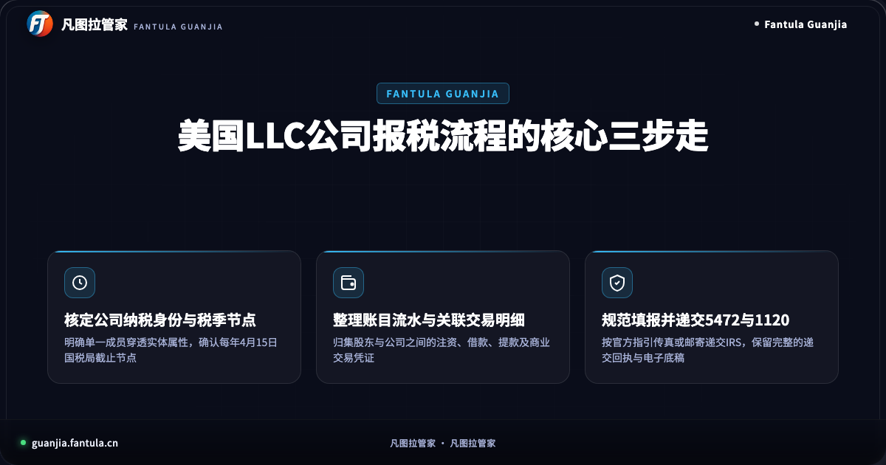

# 最新美国LLC公司报税流程：跨境新手如何合规申报看这3步

最新美国LLC公司报税流程怎么走？对于中国非美籍出海创业者全资持有的单一成员LLC（Foreign-owned Single-Member LLC），按美国税法属于被忽略实体（Disregarded Entity）：即使在美国境内没有实体办公室、没有雇佣员工，且没有产生源自美国的有效关联收入（FDAP / ECI），**每年依然必须在截止日前向美国国税局（IRS）递交 Form 5472 和 Form 1120 进行信息申报与关联交易披露**。其标准流程主要分为三步：一是确认纳税实体类别与申报截止期（通常为每年4月15日），二是整理年度注资、提现与业务流水并如实填写关联交易，三是通过正规渠道向 IRS 递交申报并妥善归档官方回执。

很多刚接触跨境外贸、跨境电商以及独立软件出海的创业者常常误以为“没有利润就等于不用报税”，直到收到国税局高达25000美元的迟报罚款信才追悔莫及。本文为您全面拆解标准报税流程与核心避坑指南，助您合规出海。

## 一、美国LLC公司报税流程的核心三步走

要想按时保质完成全套申报，理清操作节奏至关重要：

1. **核定公司纳税身份与税季节点**：非美籍纳税人持有的单一成员LLC，在联邦税务层面上被视作穿透实体。这意味着公司本身无需在联邦层面缴纳双重公司所得税，但必须在每年4月15日之前（遇周末或节假日顺延）向国税局提交年度申报。若确需更多准备时间，必须在此节点前提交Form 7004申请延期。
2. **整理账目流水与关联交易明细**：Form 5472的核心是披露外资LLC与其外国持有人（即中国股东个人或母公司）之间的“可报告交易（Reportable Transactions）”。这包括股东向公司的初始注资、公司向股东的利润分派、资金借贷、商标及知识产权使用费，以及代垫费用等。所有流水均须有清晰可追溯的银行账单和收支明细支持。
3. **规范填报并递交5472与1120表格**：将整理完备的数据准确填入Form 5472，并连同Form 1120的前两页（作为封面附表）一并装订。由于外资单一成员LLC在税法上属于特殊处理实体，IRS目前通常要求通过国际传真或挂号国际邮寄的方式向专门的海外处理中心递交，并在发送后永久保存带有时间戳的传输确认单。

## 二、合规主动申报 vs 逾期忽略申报

按期申报与忽视申报的后果有着天壤之别，跨境创业者千万不可存侥幸心理：

根据美国《国内税收法典》第6038A条规定，未在规定期限内递交Form 5472，或提交不完整、虚假信息的，每个违规年度将面临起步25000美元的严厉民事罚款；在IRS发出正式催告函后仍不改正的，罚款将按月持续累计追加。此外，合规的报税底稿是维系跨境商业银行账户（如Mercury、Relay、Stripe等）正常运转的核心凭证。一旦主体在税务系统出现异常标记，往往会导致资金链被风控冻结。

按期完成申报其实是一项流程清晰、成本极其透明的常规合规动作，远比事后遭遇账户封禁或高昂申诉罚金要轻松得多。

## 三、跨境新手报税必须把牢的3个避坑原则

在具体推进申报工作时，新手创业者建议牢记以下3个实用准则：

- **切忌把“零收入”等同于“免申报”**：即使公司全年在银行账户中没有一笔销售进账，哪怕只有一笔股东自掏腰包的注册资本金划入，这也属于法定的可报告关联交易，依然必须依法申报Form 5472。
- **尽早申请并妥善保管EIN税号**：雇主身份识别号（EIN）是向国税局申报任何税务表格的必备法律代码。成立公司后应第一时间获取IRS官方核发的CP575确认函，避免临近申报截止日因缺少税号而无法交表。
- **留存完整的递交凭据与官方回执**：向国税局递交纸质或传真报表后，务必将传真成功确认单、快递挂号信追踪签收记录以及填报底稿以电子版形式妥善归档，至少保存3至5年以备随时核验。

## 四、常见问题（FAQ）

### 美国llc公司报税流程主要有哪些表格？
非美籍单一成员外资LLC每年核心申报表格为 IRS Form 5472（外资公司关联交易申报表）与 Form 1120（美国公司所得税申报表，作为附带外封提交），主要用于披露股东身份与资金往来信息。

### 美国llc公司纳税需要交多少所得税？
如果外资单一成员LLC在美国境内没有实体办公地、没有美国员工，且不从事美国境内贸易或商业活动（ETBUS），其产生的利润通常无需缴纳美国联邦企业所得税，税收穿透至非居民股东所在国进行纳税申报。

### 跨境电商卖家美国公司怎么报税更省心？
建议在公司设立之初即建立规范的记账习惯，保留完整的注资、提款及商业收支流水；在每年税季开启时，依托明码标价的专业机构协助审核数据、编制表格并递交IRS，确保合规无虞。

## 五、关于凡图拉管家

凡图拉管家（guanjia.fantula.cn）帮出海创业者、跨境卖家和独立开发者用中文办美国公司：怀俄明州 LLC 设立、注册代理人、EIN 税号、年报与 5472 申报，到公司注销都能代办。每一项费用事先列清楚，州政府和 IRS 的官方文件电子归档，随时可查。

官网：https://guanjia.fantula.cn

---

> 原文：[最新美国LLC公司报税流程：跨境新手如何合规申报看这3步](https://guanjia.fantula.cn/help/article/us-llc-tax-filing-process-guide)
