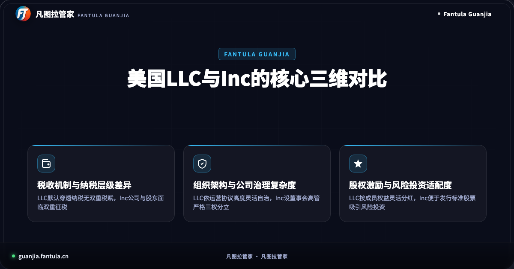
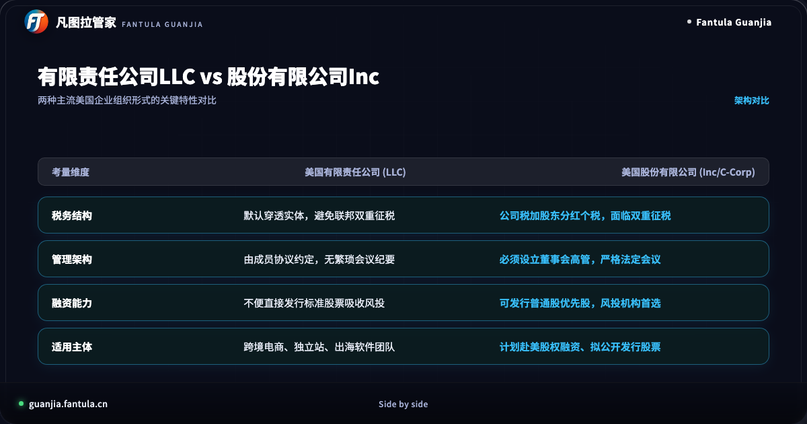
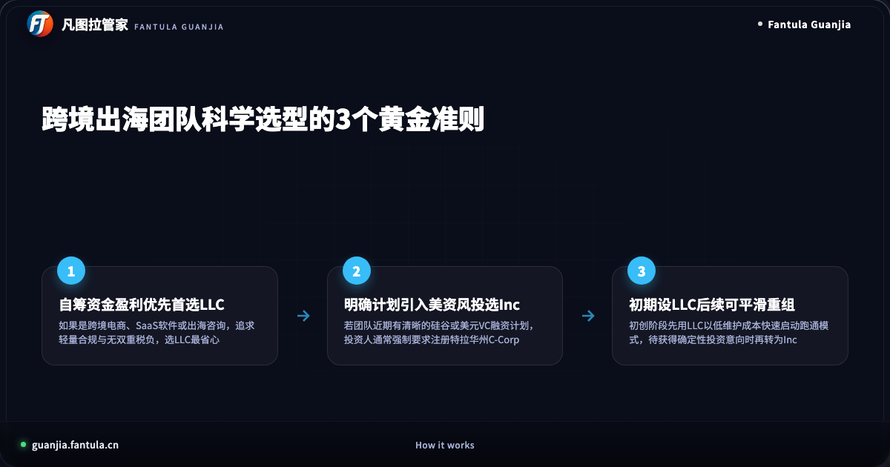

# 最新美国LLC和Inc区别：出海如何选看这3点

美国LLC和Inc有什么区别？出海创业究竟该怎么选？对于中国出海创业者、跨境电商卖家和独立开发者来说，在美国设立商业主体最常见的两种企业形态就是有限责任公司（LLC，Limited Liability Company）与股份有限公司（Inc / C-Corporation）。**二者的核心区别主要体现在三个维度：税收机制（穿透纳税 vs 双重征税）、公司治理结构（成员协议灵活自治 vs 董事会法定三权分立）、以及资本运作与融资便利度（成员权益利润分配 vs 标准股份吸引风投）**。简而言之，以日常业务经营、利润自筹分配为主的跨境团队首选LLC；而明确计划吸收美元风险投资（VC）或赴美公开发行股票的科技项目则更适合Inc。

很多初涉出海的团队在起步阶段容易人云亦云，有的跟风注册了复杂的C-Corp，结果每年面临沉重的双重税负和繁琐的法定会议纪要；有的需要吸收外部机构投资却设立了LLC，导致后续不得不耗费额外成本进行公司重组。本文为您系统梳理两者的核心差异与选型准则，助您走稳出海第一步。

## 一、美国LLC与Inc的核心三维对比

理清两种公司形式的内在运作逻辑，主要看以下三个关键层面的差异：

1. **税收机制与纳税层级差异**：根据美国国税局（IRS）法规，美国LLC在联邦税法上默认属于税收穿透实体（Pass-Through Entity）。这意味着公司主体本身无需在联邦层面缴纳21%的企业所得税，其经营收益直接穿透至股东层面申报，从而有效避免了双重征税；而Inc（主要指标准C-Corp）则是独立的法人纳税主体，企业首先就其净利润缴纳联邦和州级企业所得税，随后在向股东分配股息红利时，股东个人还需再次就该笔分红缴纳个人所得税，形成典型的“双重税收（Double Taxation）”。
2. **组织架构与公司治理复杂度**：LLC的组织治理高度灵活，其最高宪制文件是《公司运营协议》（Operating Agreement）。成员可以高度自主地约定出资比例、表决权分配与管理方式，甚至可以指定单个经理人全权打理，通常无需强制召开年度股东大会或记录繁琐的董事会决议；相反，Inc拥有极其严谨的法定管理架构，必须设立股东大会、董事会（Board of Directors）以及高管团队（Officers，如CEO、CFO），每年必须依州法按期召开股东会和董事会并保留详尽的书面会议纪要（Corporate Minutes）。
3. **股权激励与风险投资适配度**：Inc可以发行标准化普通股、优先股（Preferred Stock），并能非常便利地设立员工股票期权池（ESOP），因而硅谷乃至全球主流美元风险投资基金几乎只接受投资于C-Corp主体；而LLC的基础权益单元是成员份额（Membership Interest），不设标准化股票，通常只能以利润分红权或影子份额的形式激励核心人员，且风投机构受制于自身基金税收穿透限制，一般不会直接向LLC注资。

## 二、有限责任公司LLC vs 股份有限公司Inc

为了更直观地对比两者的法律与财务特性，我们将主要权衡要素对比如下：

从日常合规和维系成本来看，LLC的年度维护要求相对更加轻量，适合自负盈亏、注重现金流回收的实用型业务；Inc则更像是一台为资本扩张而设计的精密法律机器，更适合追求指数级增长的高研发、高融资科技团队。

选型并没有绝对的高下之分，关键在于公司设立的目的究竟是稳健运营产生现金流，还是为了在资本市场上快速募资扩张。

## 三、跨境出海团队科学选型的3个黄金准则

结合中国跨境出海群体的实际业务特点，建议遵循以下3条选型准则：

- **自筹资金、盈利导向业务首选LLC**：如果你从事的是亚马逊等跨境电商、海外独立站收款、SaaS独立软件开发、数字营销或离岸外贸咨询，团队无需依赖外部机构注资，核心目标是控制合规成本并快速回款分红，那么设立怀俄明州等免州所得税州的LLC是性价比最高、管理最省心的方案。
- **明确计划引入美元机构风投选Inc**：如果你的项目是前沿AI、生物科技或硬科技出海，创始团队明确需要在短期内入驻硅谷孵化器或向美元VC机构融资，那么建议一步到位直接设立特拉华州（Delaware）的C-Corp，因为机构投资人通常只接受成熟标准化的特拉华C-Corp法律架构。
- **初创阶段可先LLC后续再做平滑转制**：对于商业模式尚在验证期、暂不确定能否融到资的早期团队，先以较低成本设立LLC快速启动业务也是可行的。美国绝大多数州的商事法均支持通过法定转换（Statutory Conversion）或资产吸收合并，将LLC平滑重组为C-Corp，既节约了早期的合规开支，又保留了未来接入资本市场的灵活性。

## 四、常见问题（FAQ）

### 美国llc和inc的区别主要体现在哪些方面？
核心区别在于税收机制、治理结构与融资路径：LLC默认享受穿透纳税无联邦双重税赋且管理高度自主；Inc作为独立法人存在公司税与分红税双重征税，但拥有标准股份制架构，是外部风险投资机构的必备标配。

### 美国llc公司纳税是怎么计算的？
非美籍外国人全资持有的单一成员LLC，按IRS税法被视为被忽略实体（Disregarded Entity）。若在美国本土没有实体经营场所且无产生美国有效关联收入（ETBUS），通常无需缴纳联邦企业所得税，只需每年向IRS递交Form 5472和Form 1120进行关联交易与主体信息披露。

### 美国llc是什么意思？适合哪些出海场景？
LLC即有限责任公司（Limited Liability Company），它兼具股份有限公司的股东有限财产责任保护与合伙企业的税收穿透优势。它极其适合跨境电商开店收款、独立开发者SaaS变现、海外技术服务及自营数字贸易等各类出海应用场景。

## 五、关于凡图拉管家

凡图拉管家（guanjia.fantula.cn）帮出海创业者、跨境卖家和独立开发者用中文办美国公司：怀俄明州 LLC 设立、注册代理人、EIN 税号、年报与 5472 申报，到公司注销都能代办。每一项费用事先列清楚，州政府和 IRS 的官方文件电子归档，随时可查。

官网：https://guanjia.fantula.cn

---

> 原文：[最新美国LLC和Inc区别：出海如何选看这3点](https://guanjia.fantula.cn/help/article/us-llc-vs-inc-corporation-differences-guide)
